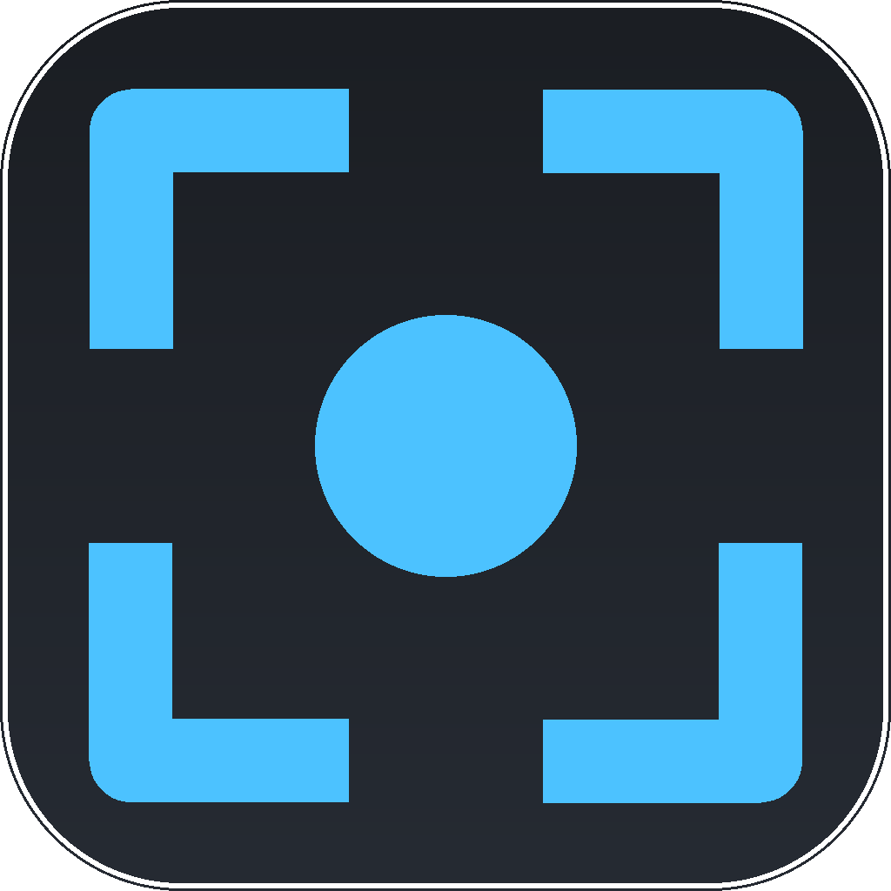
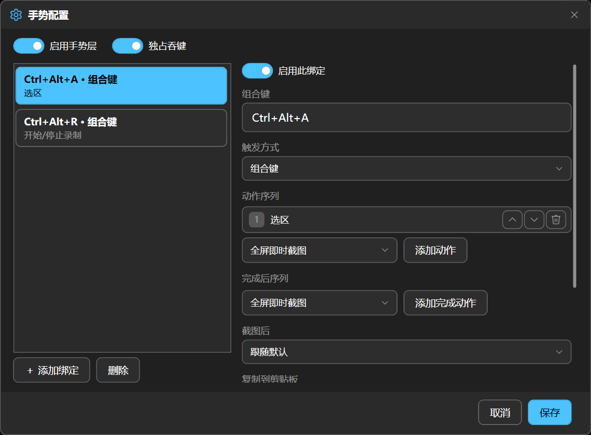
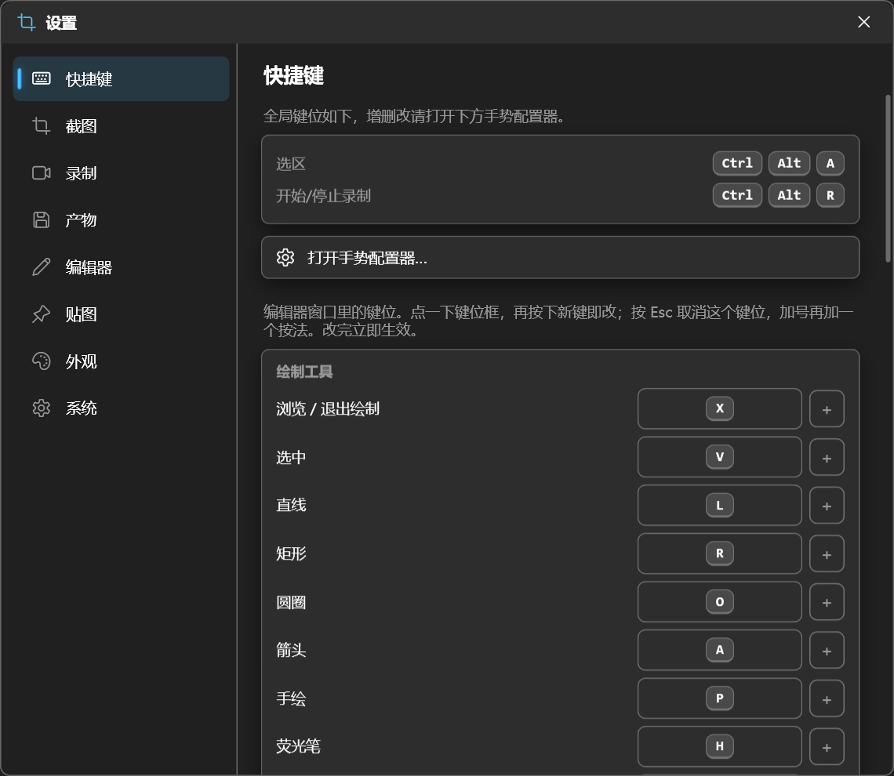

<div align="center">



# FrameCapture

**截得干净，用得顺手。**

为 Windows 准备的截图、录制、OCR、标注与贴图工具。

[](https://github.com/NekoWs/FrameCapture/releases/latest)
[](https://github.com/NekoWs/FrameCapture/releases/latest)
[](LICENSE)

[**下载**](https://github.com/NekoWs/FrameCapture/releases/latest) ·
[官网](https://nekows.github.io/FrameCapture/) ·
[English website](https://nekows.github.io/FrameCapture/en/) ·
[反馈问题](https://github.com/NekoWs/FrameCapture/issues)

</div>

---

FrameCapture 将截图、录制和后续处理放在同一套工作流程里。快捷键连接行为入口，选区上方的按钮决定进入截图还是录制分支，复制、保存、编辑等后续动作都可以自行配置。

## 功能

- **截图与录制**：选择区域或窗口，支持控件吸附、定格选区和可配置帧率。
- **滚动截图**：手动或自动滚动，将长内容拼接成一张图片。
- **标注编辑**：箭头、文字、荧光笔、马赛克、裁剪与撤销重做。
- **录制剪辑**：逐帧查看、设置起止点，导出 GIF、MP4 或 WebM。
- **离线 OCR**：默认使用 Windows 内置引擎，可选下载 PaddleOCR small 或 medium；支持在原图上选字复制。
- **桌面贴图**：将参考图固定在屏幕上，支持拖动、缩放、旋转和透明度调整。
- **可配置行为**：组合键与轻点、按住、放开手势，连接动作卡片与事件分支。
- **桌面集成**：中英文、明暗主题、自启动、可选管理员运行和应用内更新。

## 界面预览

<div align="center">

</div>

<details>
<summary>查看快捷键与预设配置</summary>



</details>

更多界面和交互演示见 [官网](https://nekows.github.io/FrameCapture/)。

## 下载与安装

前往 [最新 Release](https://github.com/NekoWs/FrameCapture/releases/latest)，下载 **FrameCapture-Setup-版本号-x64.exe**。

| 项目 | 要求 |
| --- | --- |
| 系统 | Windows 10 2004 及以上，或 Windows 11 |
| 架构 | x64 |
| 运行环境 | .NET 8 Desktop Runtime，由安装器检测并按需下载 |

安装器会识别已有安装并进行升级。启动后程序常驻托盘，可以从托盘菜单打开设置。

截图和 GIF 导出无需视频组件。在「设置 → 录制 → 导出」选择 MP4 或 WebM 后，点击出现的下载按钮即可安装对应的精简编码组件，页面显示下载进度。两种格式独立下载，已安装的完整 FFmpeg 也可直接使用。Codecs-Setup 可一次安装两种格式。

## 快速开始

1. 打开「设置 → 快捷键」，选择适合自己的预设。
2. 按快捷键进入选区，拖动选框或吸附窗口。
3. 使用选区上方的按钮切换截图或录制。
4. 在「设置 → 行为」中配置各分支的复制、编辑、保存等动作。

### 三种预设

| 预设 | 使用方式 |
| --- | --- |
| 双快捷键 | 默认 `Ctrl+Alt+A` 进入截图，`Ctrl+Alt+R` 进入录制 |
| 选区与捕获 | 一个快捷键仅保存选区；另一按键轻点截图、按住录制、放开停止 |
| 单快捷键 | 一个入口打开选区，使用上方按钮选择截图或录制分支 |

修改预设后会自动保存到「自定义」方案。仅选区得到的范围会持续复用，直到重新选择或主动清除。

### 行为配置

快捷键负责决定从哪里开始，行为负责决定接下来做什么。

- 拖动动作卡片调整顺序，添加或删除动作。
- 分别配置截图、录制、取消和失败等事件的后续处理。
- 为录制准备、开始、停止，以及编辑器保存、关闭等事件配置动作。
- 在一个流程中组合多个捕获与处理步骤，共享行为可以被多个入口复用。

## 更新

「设置 → 系统」控制启动时自动检查更新；「设置 → 关于」可以手动检查。

发现新版后，可更新、取消或跳过该版本。下载显示进度，安装器完成升级后重新启动程序。

## 从源码构建

开发环境：

- Windows x64。
- .NET 8 SDK 和 .NET 10 SDK。
- PowerShell 7。
- 发布 NativeAOT 常驻组件时，需要 MSVC x64 工具链及 Windows SDK，可通过 Visual Studio 的「使用 C++ 的桌面开发」安装。

```powershell
git clone https://github.com/NekoWs/FrameCapture.git
cd FrameCapture
dotnet build FrameCapture.slnx -c Debug
```

构建主程序位于：

```text
src/FrameCapture/bin/x64/Debug/net8.0-windows10.0.19041.0/FrameCapture.exe
```

构建与静态检查：

```powershell
pwsh -NoProfile -File scripts/guardrail.ps1 -Quick
```

生成本地安装包：

```powershell
pwsh -NoProfile -File scripts/publish-release.ps1 -Flavor fd -NoRestart
```

安装包输出到 `release/`。软件发行与官网部署使用独立的 GitHub Actions 工作流。

## 反馈与贡献

欢迎通过 [Issues](https://github.com/NekoWs/FrameCapture/issues) 提交问题或建议，也欢迎 Pull Request。
报告问题时，请附上软件版本、Windows 版本、复现步骤，以及适用的截图或日志。

## 许可证

本项目采用 [GNU GPL v3.0](LICENSE)。

FFmpeg 为按格式下载的可选组件，精简构建采用 GPLv3，包含对应的许可证和来源说明。[完整对应源码与构建配方](https://github.com/NekoWs/FrameCapture/releases/download/v0.9.33/FrameCapture-video-sources-1.tar.gz)与二进制一同提供；构建入口位于 `scripts/video-components/`。
